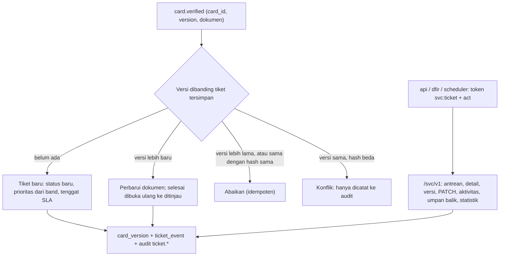

<!-- astria-logo -->
<p align="center">
  <picture>
    <source media="(prefers-color-scheme: dark)" srcset=".github/assets/astria-logo-reverse.svg">
    
  </picture>
</p>

# Astria ticket

Menyimpan kartu insiden yang sudah lolos verifier (`card.verified`) sebagai tiket, lalu melayani antrean, detail, versi, perubahan status, aktivitas, dan umpan balik untuk BFF `api` lewat `/svc/v1`.

> Status: Tahap 1 (ticket#2). Repo ini adalah submodule dari workspace `triase-dfir` (folder `ticket/`). Rancangan: `notes/2026-11-06-triase-dfir-app-ticket.md` di repo root. Lajur developer: 1.

## Tech stack

Python 3.14, FastAPI, SQLAlchemy 2.1, PostgreSQL 18, NATS JetStream, uv. Uji: pytest, hypothesis, pyright.

## Perintah

```text
uv sync                                   # butuh akses ke repo privat contracts dan common (tag git)
uv run ruff format --check . && uv run ruff check . && uv run pyright
uv run pytest                             # uji DB dilewati tanpa ASTRIA_TEST_DATABASE_URL
sh ../common/template/localtest.sh        # di kontainer py devenv: uji terhadap salinan kerja common dan contracts
```

Menjalankan bersama layanan lain: `pwsh ../devenv/scripts/dev.ps1 up`, lalu `dev.ps1 smoke`.

## Cara kerja



- **Konsumen** `card.verified` (durable `ticket`): dokumen kartu disimpan apa adanya per versi (`card_version`, hash SHA-256 JSON kanonik). Tiket baru mendapat prioritas dari band (KRITIS P1, TINGGI P2, SEDANG P3, RENDAH P4) dan tenggat tanggapan awal dari SLA per band. Versi baru menghitung ulang prioritas hanya bila prioritas belum diubah analis, dan membuka ulang tiket `selesai` ke `ditinjau`.
- **Status**: `baru -> ditinjau -> diselidiki -> eskalasi -> selesai`. Transisi diperiksa di `status.py`: dari `eskalasi` hanya dfir/admin; `selesai` wajib kesimpulan (`insiden_benar`, `bukan_insiden`, `ditutup_tanpa_tindakan`).
- **Konkurensi**: `PATCH` wajib `if_row_version`; nilai lama dijawab 409 `VERSI_BENTROK` beserta `error.row_version` terbaru.
- **Idempoten**: event masuk ditahan `processed_events` (Consumer common). Aktivitas dan umpan balik menerima header `Idempotency-Key`; ulangan dijawab 200 dengan hasil pertama.
- **Audit**: tiap perubahan menulis `ticket_event` dan entri audit `ticket.*` lewat outbox dalam transaksi yang sama. Isi komentar tidak dikirim ke audit, hanya panjangnya.

## API `/svc/v1`

Semua endpoint wajib token layanan audiens `svc:ticket`. Pemanggil dibatasi `ASTRIA_TICKET_CALLERS` (403 `PEMANGGIL_DITOLAK`). Pengguna dibaca dari klaim `act` (`sub`, `roles`): analis, dfir, dan admin boleh menulis, pimpinan hanya membaca. Panggilan layanan tanpa `act` hanya boleh membaca.

| Metode dan path | Isi |
|---|---|
| `GET /tickets` | Antrean terbaru dulu. Filter `status`, `priority`, `band`, `pemilik`, `host`, `dari`, `sampai` (waktu wajib berzona); `limit` 1-200; paginasi `cursor` |
| `GET /tickets/{card_id}` | Detail + `dokumen` versi terbaru + 50 aktivitas terakhir |
| `GET /tickets/{card_id}/versions[/{versi}]` | Daftar versi kartu, atau satu versi lengkap |
| `PATCH /tickets/{card_id}` | Ubah `status`, `pemilik` (`null` = lepas), `prioritas` (wajib `alasan`), `kesimpulan`, `kesimpulan_catatan` |
| `POST /tickets/{card_id}/events` | Komentar (`tipe: comment`, `isi`) atau label (`tipe: label`, `label`, `aksi` tambah/hapus) |
| `POST /tickets/{card_id}/feedback` | Umpan balik `benar`, `salah_positif`, `perlu_dfir` |
| `GET /stats` | `total`, `per_status`, `per_band`, `per_prioritas`, `sla_terlanggar` (tanggapan awal lewat tenggat), `umpan_balik`; dipakai digest scheduler |

Galat memakai bentuk common `{"error": {"code", "message", "trace_id"}}`, misalnya 404 `TIKET_TIDAK_DITEMUKAN`, 422 `TRANSISI_TIDAK_VALID`/`KESIMPULAN_WAJIB`/`ALASAN_WAJIB`, 503 `TICKET_TIDAK_SIAP`.

## Konfigurasi (env `ASTRIA_*`)

| Env | Bawaan | Isi |
|---|---|---|
| `ASTRIA_DATABASE_URL` | - | PostgreSQL milik ticket |
| `ASTRIA_NATS_URL` | - | JetStream (konsumen `ticket`, outbox audit) |
| `ASTRIA_TICKET_SLA_MENIT_KRITIS`/`_TINGGI`/`_SEDANG`/`_RENDAH` | 15 / 60 / 240 / 1440 | Tenggat tanggapan awal per band (angka contoh) |
| `ASTRIA_TICKET_CALLERS` | `["svc:api","svc:dfir","svc:scheduler"]` | Layanan yang boleh memanggil `/svc/v1` |
| `ASTRIA_TICKET_COMMENT_MAX_CHARS` | 4000 | Batas komentar, alasan, dan catatan |

### Batasan yang diketahui

- Tabel dibuat dengan `create_all` (belum ada migrasi Alembic), sama dengan layanan lain.
- `rule_ids` di detail masih kosong (`[]`); sumbernya menunggu kontrak kartu.
- Event `ticket.updated` dan `ticket.sla_breached` ke `api` belum diterbitkan; perubahan baru tercatat di audit.
- `Idempotency-Key` yang dipakai ulang dengan isi berbeda tetap mengembalikan hasil pertama (isi permintaan belum dibandingkan).
- Belum ada klaim tiket (`claim`), pengingat SLA terjadwal, dan pencarian teks.

## Alur git

Branch `{type}/{yyyyMMdd}-{taskId}-{nama}`; commit `{type}({yyyyMMddHHmm}): [{taskId}] {pesan}`, satu baris, tanpa trailer. `main` hanya berubah lewat pull request (merge rebase); jangan push langsung ke `main` dan jangan `--no-verify`.
